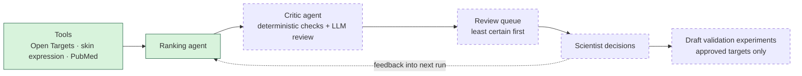

# Target Evidence Agent

A small, human-in-the-loop agent workflow that ranks candidate drug targets for a skin condition using public genetic, expression, literature and clinical evidence. A ranking agent proposes targets with cited evidence. A separate critic agent checks every claim against its sources. A scientist then reviews the least certain candidates first, and their decisions are fed into the next run.

Starting condition: **atopic dermatitis**. The condition is an input, so other conditions can be run.

> **Status: work in progress.** The data layer and the ranking agent are built and run end to end. The critic agent and the review step are being built next. See [What works now](#what-works-now) and [Coming next](#coming-next).

## How it works



Solid green = built. Dashed = planned, not built yet.

It's a small design → test → learn loop:
- **Design:** the agents gather evidence and rank candidate targets.
- **Test:** the critic checks the claims, and a scientist decides what goes forward to validation.
- **Learn:** those decisions shape the next round.

## Data sources

All public and free:

| Source | Used for |
|---|---|
| [Open Targets Platform](https://platform.opentargets.org/) (GraphQL API) | Disease lookup, target–disease association scores, drugs and their clinical stage, target aliases |
| GTEx skin expression, via Open Targets | Expression of each target in normal skin |
| [PubMed](https://pubmed.ncbi.nlm.nih.gov/) (NCBI E-utilities) | Literature search, abstracts, PMID checks |

## What works now

### Ranking agent

`python -m agent.ranker "atopic dermatitis"` ranks 5 candidate targets (`--n` to change).

- **The LLM chooses the tools.** A shared tool-calling loop (`agent/loop.py`) sends the model the tool definitions; the model decides which to call and in what order, and calls `submit_ranking` when done. The prompt suggests a path but does not enforce one.
- **Evidence rubric** (`agent/rubric.py`): each candidate is scored 0–3 on genetic association, skin expression, literature, clinical status and mechanism, and gets a cited mechanism, a novelty label (known / less explored), a confidence label and a rationale.
- **Citation rule in code:** after the run, any non-zero score without a citation is set to 0 and flagged, and the ranking is recomputed.
- **Structured output:** the answer is validated against Pydantic models (`agent/schemas.py`) before it is saved.
- **Limits:** maximum tool calls (checked before each call), cost and time. If a limit is hit, the model is asked once to submit its best answer, and the run is marked partial.
- **Provenance:** every LLM call and tool call is written to `traces/<run_id>.jsonl` (agent, model, prompt version, arguments, short result, tokens, cost). Each run is saved to `runs/<run_id>.json`.
- **Feedback input:** if `review/decisions.json` exists, past decisions for the same condition are passed to the agent as context (not evidence). The review step that produces this file is not built yet.

Example from one run on atopic dermatitis (a single run, not an evaluation):

```
rank  target    total  confidence  novelty
   1  JAK1         15  high        known
   2  IL4R         14  high        known
   3  IL13         12  high        known
   4  FLG          10  medium      less_explored
   5  TYK2          9  low         known
Tool calls 20 | cost $0.010 | 43.2 s | stop: submitted
```

All PMIDs cited in this run came from the agent's own PubMed calls in the same run. One known gap: the agent looked at only the top 10 associated targets, so IL31RA (nemolizumab) was not considered.

### Tool wrappers

Tool wrappers in `agent/tools/`, each returning typed (Pydantic) results:

| Module | Functions |
|---|---|
| `opentargets.py` | `search_disease`, `get_associated_targets`, `get_known_drugs`, `get_target_info` |
| `expression.py` | `get_skin_expression` (GTEx skin TPM and where skin ranks among tissues) |
| `pubmed.py` | `search_pubmed`, `fetch_abstracts`, `check_pmids` |
| `http.py` | Shared HTTP layer: disk cache (including GraphQL POSTs), error handling, PubMed rate limit |

- All API responses are cached on disk, so reruns are fast and cheap.
- Offline tests use recorded API responses (`tests/fixtures/`), and the agent loop is tested with a scripted fake LLM, so all tests run without network access.

## Run it locally

Requires Python 3.11+.

```bash
python -m venv .venv
source .venv/bin/activate
pip install -r requirements.txt
cp .env.example .env   # then add your keys (an NCBI API key is optional but raises the rate limit)
pytest -q
```

The ranking agent needs an [OpenRouter](https://openrouter.ai/) API key and a tool-capable model in `.env` (`OPENROUTER_API_KEY`, `RANKER_MODEL`). Then:

```bash
python -m agent.ranker "atopic dermatitis"
```

Quick check of the wrappers:

```bash
python -c "from agent.tools.opentargets import search_disease; print(search_disease('atopic dermatitis')[0])"
```

## Coming next

Not built yet:
- Critic agent: deterministic citation checks, then an LLM review of each claim
- Uncertainty-ordered review queue, with reviewer decisions fed into the next run
- Draft experiment proposals for approved targets
- Streamlit review UI, evaluation against a benchmark of known targets, and deployment

## Limitations

- Skin expression comes from healthy GTEx skin, not lesional skin or hair follicles.
- Secreted cytokines (for example IL13) show very low bulk-skin expression even when they're central to the disease.
- Language models may already know well-studied targets from their training data. That's why every score will need a tool citation.
