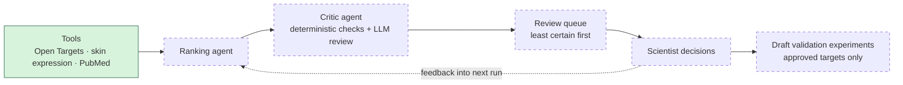

# Target Evidence Agent

A small, human-in-the-loop agent workflow that ranks candidate drug targets for a skin condition using public genetic, expression, literature and clinical evidence. A ranking agent proposes targets with cited evidence. A separate critic agent checks every claim against its sources. A scientist then reviews the least certain candidates first, and their decisions are fed into the next run.

Starting condition: **atopic dermatitis**. The condition is an input, so other conditions can be run.

> **Status: work in progress.** The data layer (tool wrappers, caching, tests) is built. The agents and the review step are being built next. See [What works now](#what-works-now) and [Coming next](#coming-next).

## How it works



Solid green = built. Dashed = planned, not built yet.

It's a small design → test → learn loop:
- **Design:** the agents gather evidence and rank candidate targets.
- **Test:** the critic checks the claims, and a scientist decides what goes forward to validation.
- **Learn:** those decisions shape the next round.

## Data sources

All public and free:

| Source | Used for |
|---|---|
| [Open Targets Platform](https://platform.opentargets.org/) (GraphQL API) | Disease lookup, target–disease association scores, drugs and their clinical stage, target aliases |
| GTEx skin expression, via Open Targets | Expression of each target in normal skin |
| [PubMed](https://pubmed.ncbi.nlm.nih.gov/) (NCBI E-utilities) | Literature search, abstracts, PMID checks |

## What works now

Tool wrappers in `agent/tools/`, each returning typed (Pydantic) results:

| Module | Functions |
|---|---|
| `opentargets.py` | `search_disease`, `get_associated_targets`, `get_known_drugs`, `get_target_info` |
| `expression.py` | `get_skin_expression` (GTEx skin TPM and where skin ranks among tissues) |
| `pubmed.py` | `search_pubmed`, `fetch_abstracts`, `check_pmids` |
| `http.py` | Shared HTTP layer: disk cache (including GraphQL POSTs), error handling, PubMed rate limit |

- All API responses are cached on disk, so reruns are fast and cheap.
- Offline tests use recorded API responses (`tests/fixtures/`), so they run without network access.

## Run it locally

Requires Python 3.11+.

```bash
python -m venv .venv
source .venv/bin/activate
pip install -r requirements.txt
cp .env.example .env   # then add your keys (an NCBI API key is optional but raises the rate limit)
pytest -q
```

Quick check of the wrappers:

```bash
python -c "from agent.tools.opentargets import search_disease; print(search_disease('atopic dermatitis')[0])"
```

## Coming next

Not built yet:
- Ranking agent: LLM-driven tool use, an evidence rubric, and a cited mechanism for each candidate
- Critic agent: deterministic citation checks, then an LLM review of each claim
- Uncertainty-ordered review queue, with reviewer decisions fed into the next run
- Draft experiment proposals for approved targets
- Streamlit review UI, evaluation against a benchmark of known targets, and deployment

## Limitations

- Skin expression comes from healthy GTEx skin, not lesional skin or hair follicles.
- Secreted cytokines (for example IL13) show very low bulk-skin expression even when they're central to the disease.
- Language models may already know well-studied targets from their training data. That's why every score will need a tool citation.
