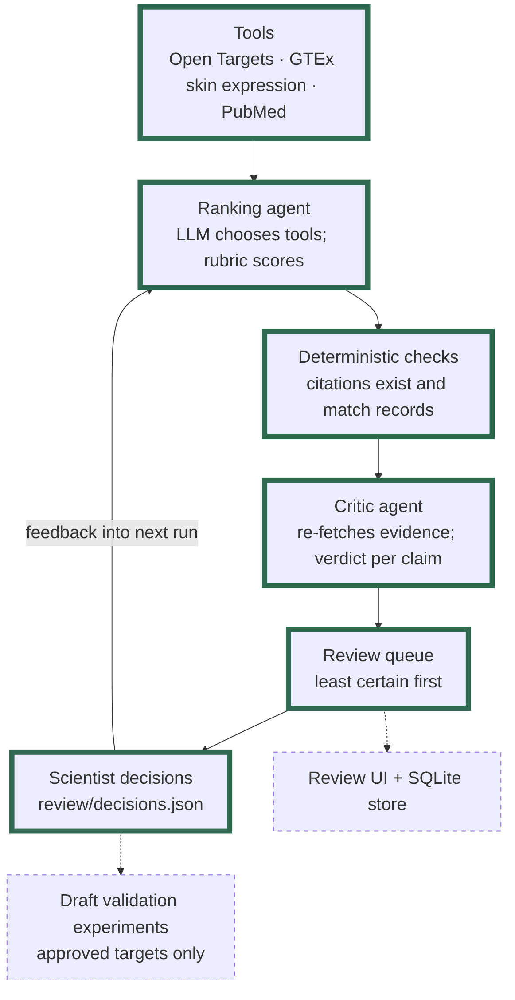

# Target Evidence Agent

## What it does

A small, human-in-the-loop workflow of two agents that ranks candidate drug targets for a skin condition using public genetic, skin expression, literature and clinical evidence. A **ranking agent** chooses which databases to query, scores each candidate on an evidence rubric and cites a source for every score. Code checks every citation, and a separate **critic agent** (a different model) re-reads the cited evidence and gives a verdict on every claim. A scientist then reviews the least certain candidates first, and their decisions are passed to the next run as context.

It's a small design → test → learn loop:
- **Design:** the ranking agent gathers evidence and proposes ranked candidates, each with a cited mechanism.
- **Test:** deterministic checks and the critic agent test every claim against its source; a scientist decides which candidates go forward.
- **Learn:** the scientist's decisions shape the next run, and each run is compared with the previous one.

Starting condition: **atopic dermatitis**. The condition is an input, so other conditions can be run.

> **Status: work in progress.** The two agents and a command-line review loop run end to end. A review UI, evaluation and deployment are planned (see [Coming next](#coming-next)).

## Architecture



Green outline = built and working. Dashed = planned, not built yet. Today, decisions are written by hand in `review/decisions.json` from the review queue printed in the terminal.

## Why this design

- **A generator–critic pair rather than many agents.** One agent proposes, a second checks, similar in spirit to the review roles in AI co-scientist systems, at small scale. The critic runs on a different model to reduce shared blind spots, and has only read-only tools to re-fetch the evidence it was given.
- **Deterministic checks before LLM judgement.** Code first confirms what code can: each PMID exists and names the target (or a drug acting on it), each cited record exists, and no score is above what its record supports. Failed checks remove the citation or cap the score, and every change is flagged. Only then does the critic judge whether the evidence supports each claim.
- **A human approval gate.** Candidates are ordered for review by a stated uncertainty rule (a simple form of active learning: uncertainty sampling for human review). Reviewer decisions are context for the next run, not evidence: every score still needs a tool citation. Draft experiments will only be generated for approved targets.

## What works now

- **Ranking agent** (`agent/ranker.py`): the LLM decides which tools to call and in what order through a shared tool-calling loop (`agent/loop.py`) with tool-call, cost and time limits. Each candidate is scored 0–3 on genetic association, skin expression, literature, clinical status and mechanism, with a cited mechanism, a novelty label, a confidence label and a rationale. Any non-zero score without a citation is set to 0 and flagged.
- **Critic** (`agent/critic.py`): deterministic checks, then a critic agent that gives each claim a verdict (supported, partial, unsupported); unsupported claims are set to 0. A drug counts fully towards clinical status only if this target is its sole mechanism; multi-target drugs are noted, not removed.
- **Learn step** (`agent/learn.py`): an uncertainty-ordered review queue, reviewer decisions fed into the next run, and a comparison with the previous run (targets added or dropped, rank changes, and the reviewer's edited scores).
- **Provenance:** every LLM and tool call of both agents is written to `traces/<run_id>.jsonl`, with model, prompt version, tokens and cost. Each run is saved to `runs/<run_id>.json` (before and after the critic) and as two tab-delimited files that open in Excel. An example run and trace are in `runs/example.json` and `traces/example.jsonl`.
- **Tests:** 31 offline tests, using recorded API responses and a scripted fake LLM.

Provenance summary and review queue from one real run (the second run on atopic dermatitis, after one round of reviewer feedback). This is a single run, not an evaluation:

```
rank  target    total  confidence  novelty
   1  IL4R         14  high        known
   2  JAK1         13  high        known
   3  IL13         12  high        known
   4  IL31RA       12  medium      known
   5  FLG          12  medium      less_explored

Provenance summary
  Deterministic checks: targets 5/5, PMID citations 25/25, record citations 15/15, scores within record 13/13
  Critic verdicts: 28 supported, 2 partial, 0 unsupported; 1 confidence flag(s)
  ranker  26 tool calls | $0.020 |  60.9 s | stop: submitted (anthropic/claude-haiku-5.5, ranker-v3)
  critic  13 tool calls | $0.096 | 108.4 s | stop: submitted (google/gemini-3.8-flash, critic-v3)
  total   39 tool calls | $0.116 | 169.3 s

Review queue (least certain first)
  1. FLG       4    medium confidence (+1); critic partial: literature (+1); critic: confidence too high (+1); less explored target (+1)
  2. IL31RA    2    medium confidence (+1); critic partial: skin_expression (+1)
  ...

Changes since run 20261101-121557-atopic-dermatitis
  Added: none | Dropped: none
  Rank changes: IL31RA 5 -> 4, FLG 4 -> 5
  Reviewer edit: IL31RA genetic_association: before 1, reviewer 2, now 2 (matches reviewer)
```

One run shows the feedback mechanism works; it does not show that feedback improves rankings in general.

### Run it locally

Requires Python 3.11+ and an [OpenRouter](https://openrouter.ai/) API key.

```bash
python -m venv .venv
source .venv/bin/activate
pip install -r requirements.txt
cp .env.example .env   # add OPENROUTER_API_KEY, RANKER_MODEL and CRITIC_MODEL (tool-capable models);
                       # an NCBI API key is optional but raises the PubMed rate limit
pytest -q
python -m agent.ranker "atopic dermatitis"            # ranker + critic + review queue + comparison
python -m agent.export runs/<run_id>.json             # Excel files for an earlier run
```

To give feedback, write `review/decisions.json` (see the example in the repo): for each reviewed target, the condition, the run reviewed, `approve`, `keep` or `reject`, optional edited scores, and a comment. The next run for the same condition receives it.

### Limitations

- Skin expression comes from healthy GTEx skin, not lesional skin or hair follicles; secreted cytokines (for example IL13) show very low bulk-skin expression even when central to the disease.
- The models may already know well-studied targets from training data. Every score needs a tool citation from the same run, and the checks report citations that fail.
- Runs vary: the same input can give a different shortlist. Feedback has been tested with one reviewer and a few decisions.
- The total score favours well-studied targets: literature and clinical status reward prior attention, so known targets fill the top of the list. That makes them a useful accuracy check, but less explored targets with strong genetic evidence rank lower than they should. Drugs never tested for the condition are also left out, which hides possible repurposing leads.

## How it was built

This project is AI-assisted: it was built with [Claude Code](https://claude.com/claude-code) (Anthropic) as a coding assistant. I set the scope, the design and the scientific rules (for example the evidence rubric, keeping less explored targets in view, and counting a drug fully only for its sole target), reviewed every change, and ran and checked the real runs. Claude Code guided the build, and wrote much of the implementation and tests.

## Coming next

Next: rank candidates on evidence strength (genetic association, skin expression, mechanism) separately from development maturity (literature, clinical status), so a target with strong evidence but little development stands out as an opportunity, and annotate drugs that act on a target but were developed for other conditions, as repurposing leads.

Then, more evidence, a review interface and an evaluation: a Streamlit review UI with a SQLite decision store, draft validation experiments for approved targets, ClinicalTrials.gov evidence, an evaluation against a benchmark of targets with approved or late-stage drugs (recall, citation validity, unsupported-claim rate before and after the critic, agent–reviewer agreement, cost, spread over repeated runs), and deployment on Streamlit Community Cloud.
